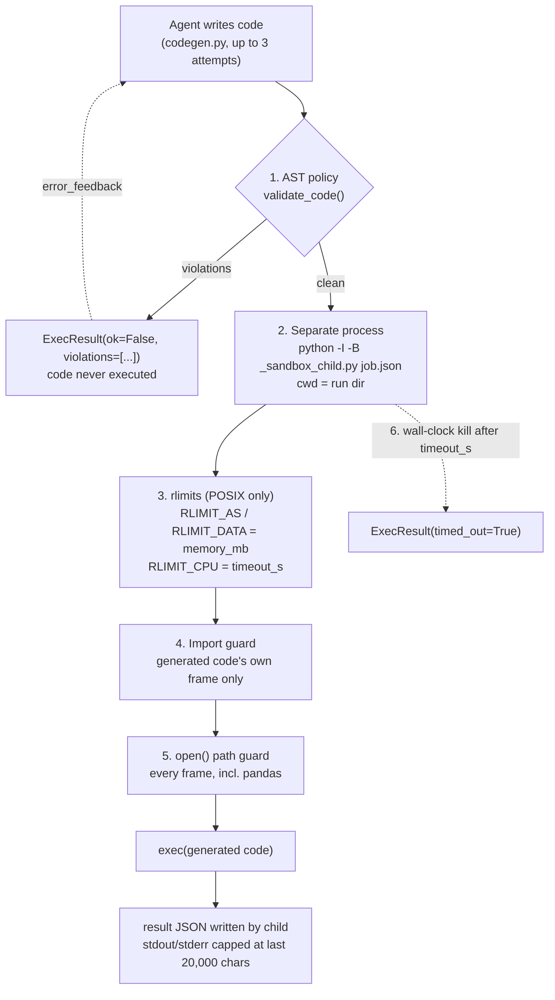

# The code-execution sandbox

The Cleaning and Feature Engineering agents write pandas that really runs. This
page lists every layer between that code and the host, with the exact values and
where each one lives. The *why* is in the README's
[Why the sandbox is a whitelist, not a blacklist](../README.md#why-the-sandbox-is-a-whitelist-not-a-blacklist).

Line numbers are as of the commit that added this page.

## Layers

| # | Layer | What it enforces | Where |
|---|-------|------------------|-------|
| 1 | **AST policy** | Parses the code and walks every node before anything runs. Rejects: any import whose top-level module is in `BANNED_IMPORTS` (42 modules: `os`, `sys`, `subprocess`, `socket`, `pickle`, `importlib`, `ctypes`, `pathlib`, …) or not in `ALLOWED_IMPORTS`; relative imports; any use of a name in `BANNED_NAMES`; any attribute access to a dunder (`x.__class__`). A syntax error is returned as a violation, not raised. | `src/tools/sandbox_policy.py:125-161` |
| 1a | Import allow-list | `pandas, numpy, sklearn, plotly, optuna, math, json, statistics, datetime, re, collections, itertools, functools, typing, warnings` | `src/tools/sandbox_policy.py:15-33` |
| 1b | Banned names | `eval, exec, compile, __import__, globals, locals, vars, getattr, setattr, delattr, breakpoint, input, memoryview, exit, quit`. `getattr`/`setattr`/`delattr` are banned because `getattr(0, "__class__")` hides dunder access from the attribute check — that route was a confirmed escape before the ban. `open` is deliberately *not* banned; it is wrapped at runtime (layer 5). | `src/tools/sandbox_policy.py:47-65` |
| 2 | **Process boundary** | The parent never execs generated code. It writes the code and a job file to `runs/{run_id}/_sandbox/`, then runs `sys.executable -I -B _sandbox_child.py job.json` with the run directory as `cwd`. `-I` (isolated mode) ignores `PYTHON*` env vars and the user site dir and keeps the script's directory off `sys.path`; the child imports nothing from this project — the whole policy arrives in the job file. | `src/tools/sandbox.py:95-121` |
| 3 | **rlimits** | `RLIMIT_AS` and `RLIMIT_DATA` set to `memory_mb` MiB (default **2048**); `RLIMIT_CPU` soft = `timeout_s`, hard = `timeout_s + 1` (a CPU-time backstop for spin loops). `RLIMIT_NPROC` is intentionally **not** set: it counts every process of the uid, and OpenBLAS threads made `import numpy` fail under a low cap. Process spawning is blocked by the import/name policy instead. **No-op on Windows** (`import resource` fails and the function returns). | `src/tools/_sandbox_child.py:24-55` |
| 4 | **Import guard** | Replaces `builtins.__import__`. Checks only imports whose calling frame is the generated file (`co_filename == code_file`), against the same allow/ban lists. Imports that pandas or sklearn make internally pass through. Defence in depth behind layer 1, which is the primary gate. | `src/tools/_sandbox_child.py:58-76` |
| 5 | **`open()` path guard** | Replaces `builtins.open` for **every** frame, including library code, so `pd.read_csv('/etc/passwd')` is refused even though the `open` happens inside pandas. Paths are `realpath`-resolved, then: writes (`w`, `a`, `x`, `+`) must be under the run directory; reads must be under the run directory or a read root — stdlib, `purelib`, `platlib`, and the interpreter's directory (sklearn/plotly read bundled files at import). A non-path argument (e.g. a raw file descriptor) is refused. | `src/tools/_sandbox_child.py:79-118`; read roots `src/tools/sandbox.py:55-63` |
| 6 | **Wall-clock kill** | `subprocess.run(..., timeout=timeout_s)` (default **120 s**). On expiry the child is killed and `ExecResult(timed_out=True)` is returned. This is the only limit that holds on Windows. | `src/tools/sandbox.py:113-128` |
| 7 | **Non-root user** (deployment) | The Docker image runs as `agent` (uid 1000); the sandbox child inherits it. | `Dockerfile:25-30` |

Order inside the child is fixed: limits, then import guard, then open guard, then
`compile` + `exec` (`src/tools/_sandbox_child.py:136-153`). The child reads its
job file and the code with the real `open` *before* the guards go in.

## Configuration

Both caps come from settings and are passed through by the only caller,
`src/tools/codegen.py:67-72`:

| Setting | Env var | Default | Defined |
|---------|---------|---------|---------|
| `sandbox_timeout_s` | `SANDBOX_TIMEOUT_S` | `120` | `src/config.py:44-46` |
| `sandbox_memory_mb` | `SANDBOX_MEMORY_MB` | `2048` | `src/config.py:47-49` |

A rejected or failed execution is fed back to the agent via
`ExecResult.error_feedback` (`src/tools/sandbox.py:43-52`) and the agent retries,
up to `MAX_ATTEMPTS = 3` (`src/tools/codegen.py:18`).

## What it does not do

- **Memory and CPU caps are POSIX-only.** On a Windows dev box only the
  wall-clock timeout applies. Deployment is Linux (Docker), where they hold.
- **No network namespace, no container per run.** Network access is blocked only
  because `socket`, `http`, `urllib*`, `requests`, `httpx` are not importable from
  generated code. A library on the allow-list that opens a socket itself would
  not be stopped. See Limitations #3 in the README.
- **No filesystem jail.** The `open()` guard covers Python-level `open`; it does
  not cover C extensions that open files directly.

## Tests

`tests/test_sandbox.py` — allowed code runs; blocked imports and dunder/`getattr`
escapes never execute (including the exact `sys.modules` escape payload); writes
and reads outside the run directory are refused, including via `pd.read_csv`; a
spin loop is killed by the timeout.
